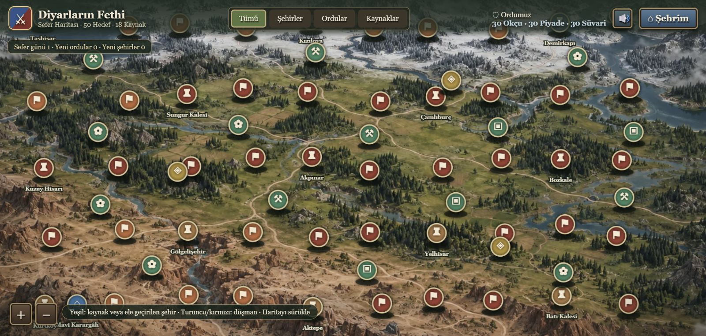
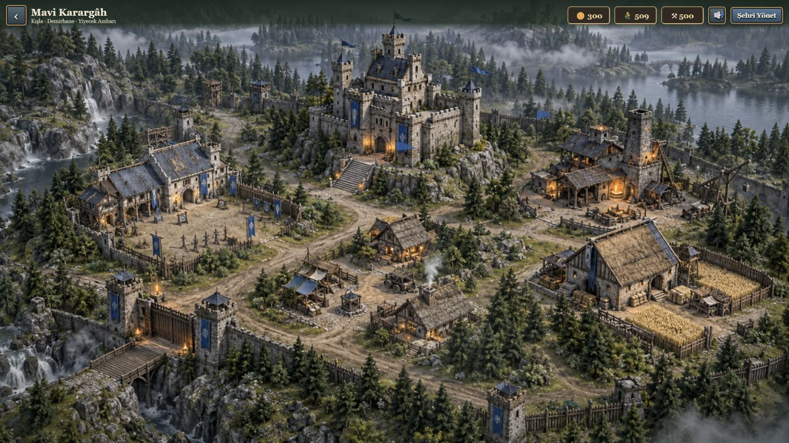
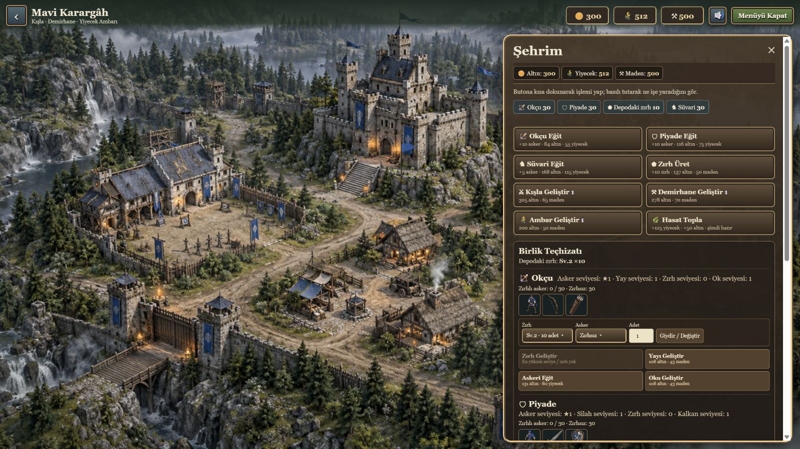
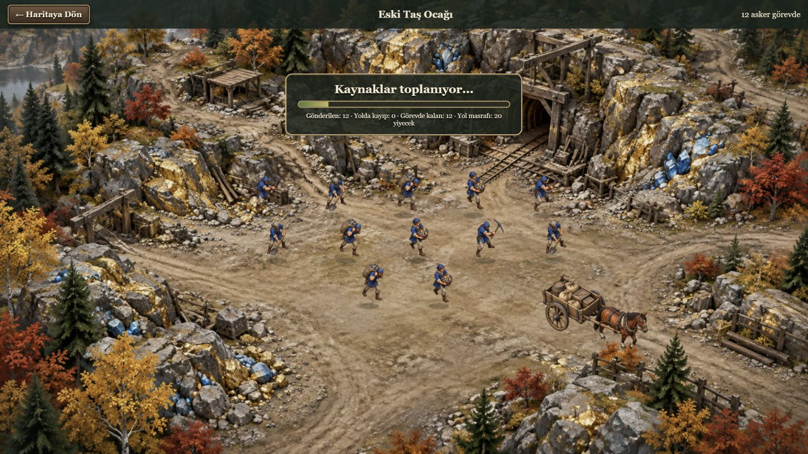
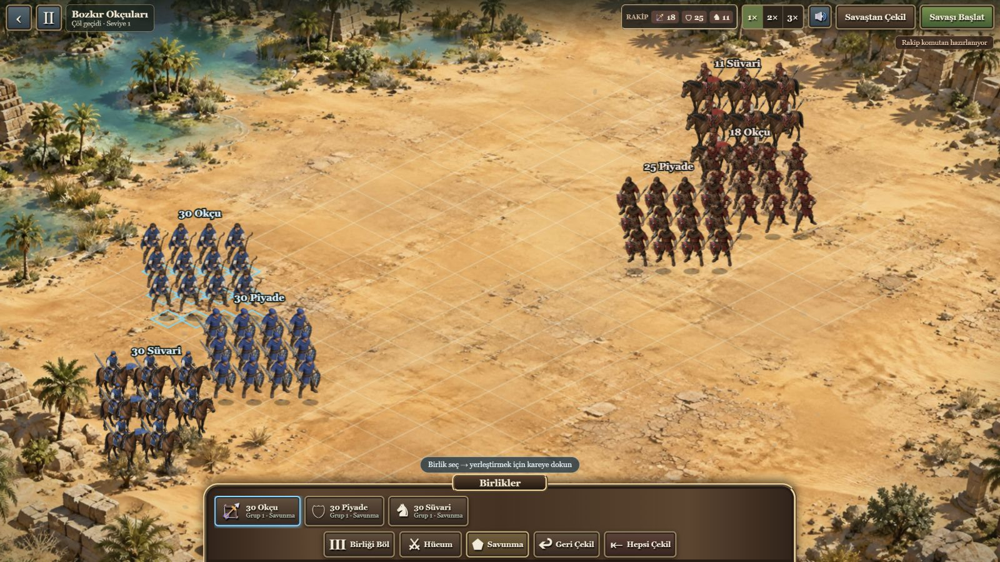
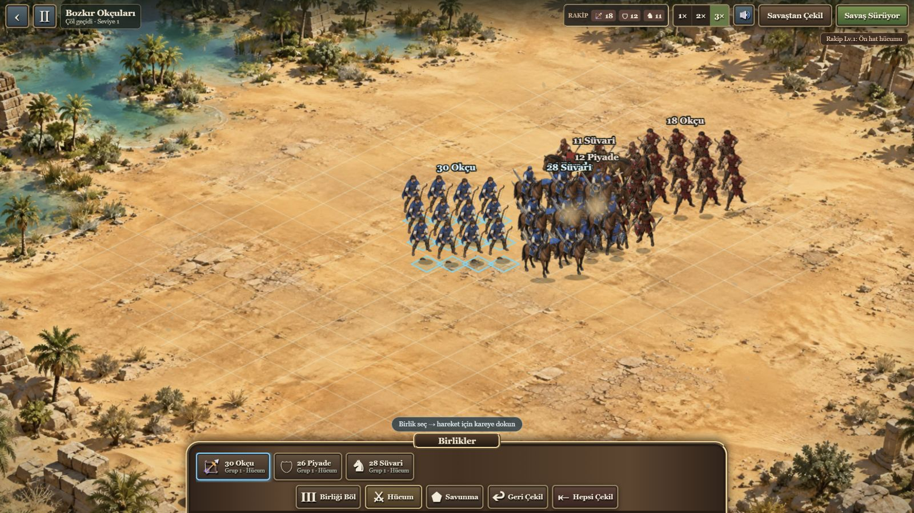
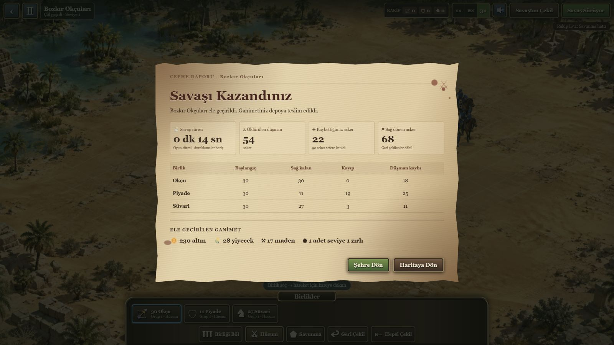

# Diyarların Fethi

Türkçe, gerçek zamanlı taktik savaşlar ile şehir ve kaynak yönetimini birleştiren mobil strateji oyunu. Ordunu kur, birliklerini savaş alanında konumlandır, şehirleri ele geçir ve değişen dünyada hâkimiyetini koru.

## Oyundan görüntüler

| Dünya haritası | Şehir ve karargâh |
|---|---|
|  |  |

| Şehir yönetimi | Kaynak toplama |
|---|---|
|  |  |

| Birlikleri konumlandırma | Gerçek zamanlı savaş |
|---|---|
|  |  |

### Ayrıntılı savaş raporu



## Öne çıkanlar

- Okçu, piyade ve süvarileri bölme, konumlandırma ve savaş sırasında yönetme
- Seviyeye göre taktik değiştiren rakip komutanlar ve şehir kuşatmaları
- 50 hedefli, orman–çöl–kar bölgelerinden oluşan dinamik sefer haritası
- Şehir, teçhizat, zırh, hasat ve kaynak seferleri yönetimi
- Çevrimdışı çalışan Capacitor Android uygulaması, yerel kayıt ve hasat bildirimleri
- Araziye göre hareketli çevre efektleri, savaş sesleri ve özgün müzik geçişleri

## Geliştirme

Gereksinimler: Node.js 20+; Android derlemesi için Android SDK ve JDK 21.

```powershell
npm install
npm run dev
npm test
npm run build
npm run apk
```

APK çıktısı: `android/app/build/outputs/apk/debug/app-debug.apk`

Ses ve görsel kaynaklarına ilişkin açıklamalar [ASSETS.md](ASSETS.md) ve [public/credits.txt](public/credits.txt) dosyalarında yer alır.

## Oyna ve indir

[🎮 Canlı oyna](https://emrebalcan.github.io/diyarlarin-fethi/) · [📱 Android APK indir](https://github.com/EmreBalcan/diyarlarin-fethi/releases/latest/download/DiyarlarinFethi.apk)

Telefonunuzun kamerasıyla QR kodu okutarak APK’yı doğrudan indirebilirsiniz.


